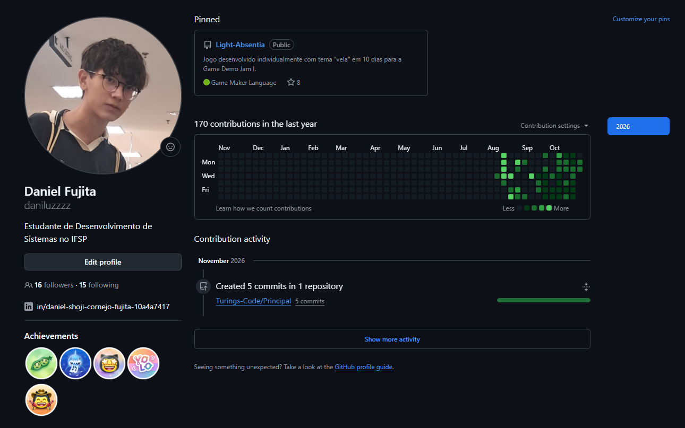

### Conta Principal Suspensa sem Motivo, Suporte não entrou em contato desde 14 dias atrás

### Sobre mim
Estudo Desenvolvimento de Sistemas no IFSP, aprofundando lógica de programação, web e boas práticas de versionamento. Crio jogos com foco em código, sistemas e arte pixel.

**Light Absentia** — puzzle/RPG feito totalmente solo (arte e código) em 10 dias para a Game Demo Jam, com mecânicas de luz e vela, IA de monstros e sistemas de colisão, iluminação, UI e áudio. Jogue em: https://daniluzzz.itch.io/light-absentia

**Turing's Code** — jogo educativo sobre Alan Turing e a Segunda Guerra Mundial, feito em grupo pelo IFSP. Fui reponsável por todo código e parte da arte.

---
### Competências

---
### Estatísticas

